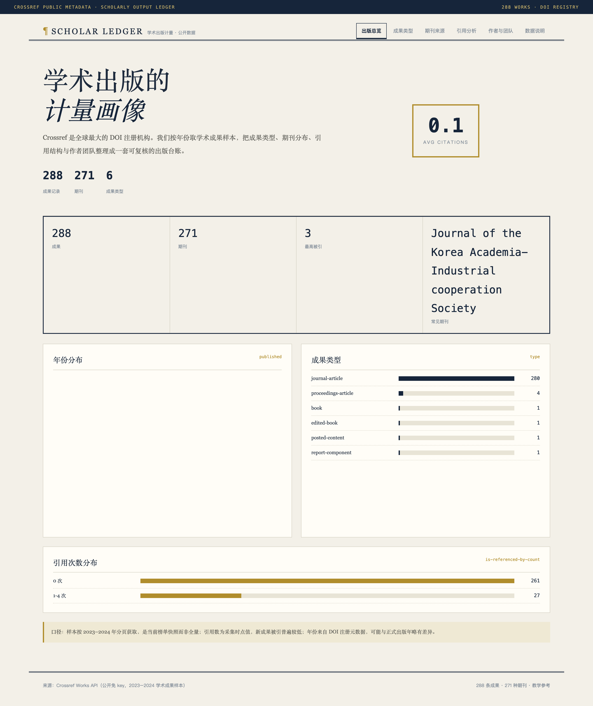
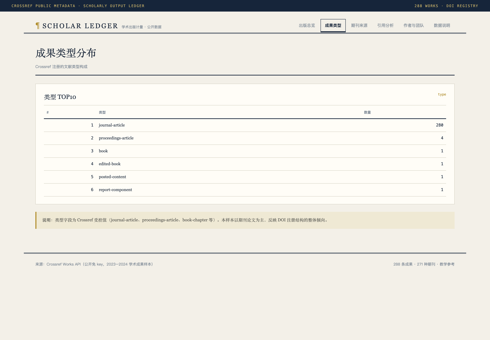
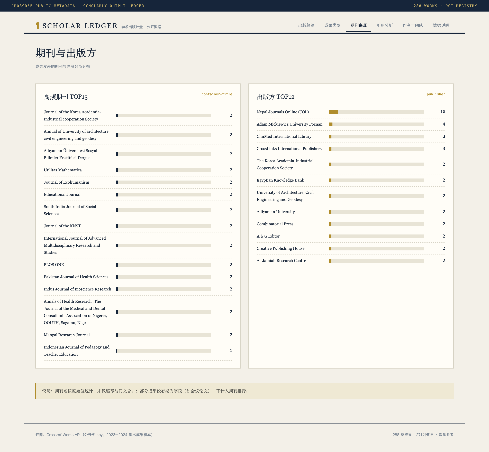
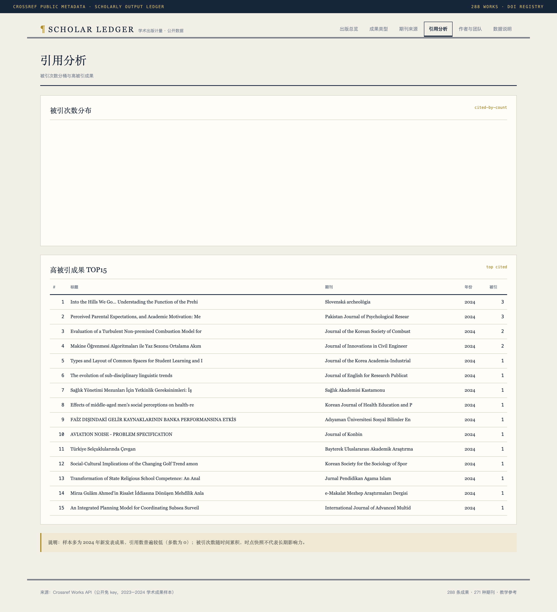
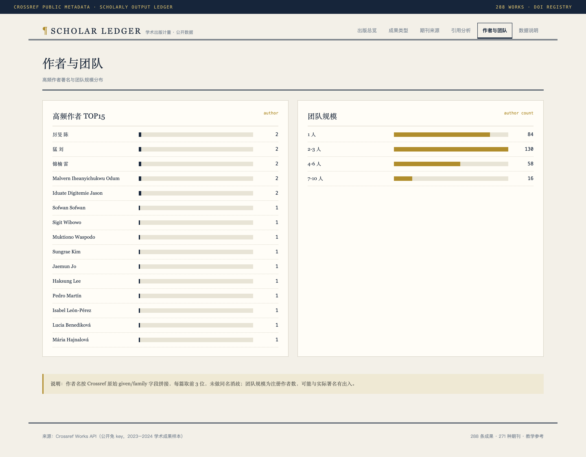
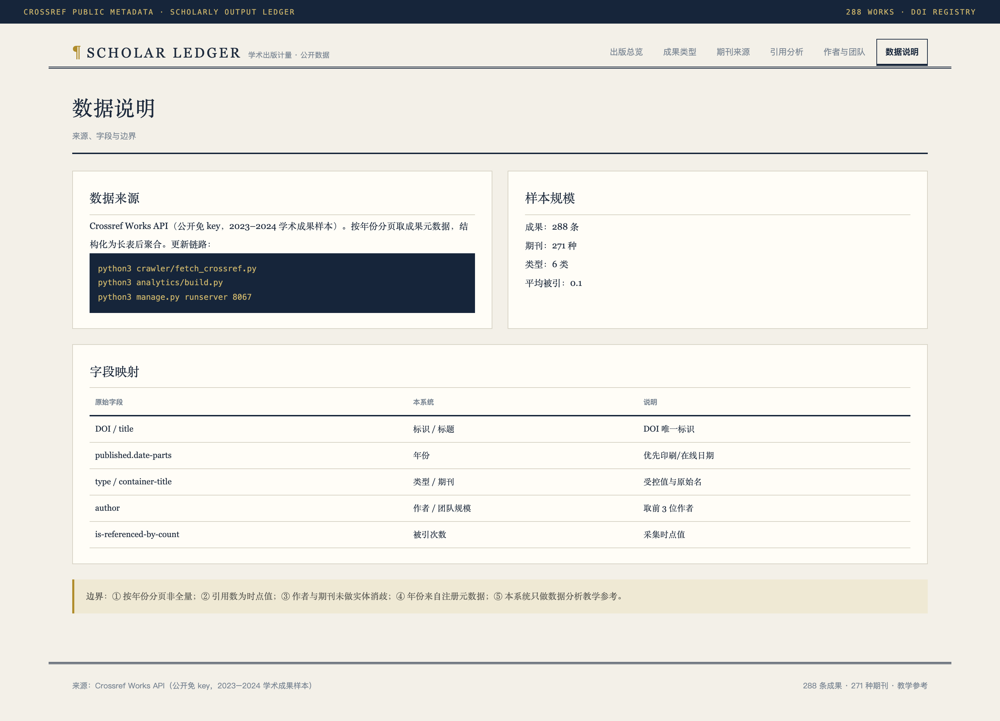

# 067 基于Crossref公开数据的学术出版计量分析系统-设计展示

> **代码有偿获取 可接受定制 微信联系方式: csbysj2020 或 ACE2487，备注(BS)**

> **完整源码与全套文档 · 在线自助获取 >>> [https://mbd.pub/o/bread/YZaWmJpsaw==](https://mbd.pub/o/bread/YZaWmJpsaw==)**

> **成品页（功能介绍 / 更多选题）>>> [https://bishe.suilang.net/products/scholar-ledger](https://bishe.suilang.net/products/scholar-ledger)**

> 

> 

## 视频

> **点击查看 >>> [https://www.bilibili.com/video/BV1PQytz7EeT/](https://www.bilibili.com/video/BV1PQytz7EeT/)**

## 项目简介

学术台账风格（藏青、烫金、衬线），区别于街机/营养标签/馆藏卡片/气象站。采集 Crossref 公开 DOI 元数据 288 条、271 种期刊，从成果类型、期刊来源、引用结构与作者团队四维分析。Django + Chart.js（本地化离线可用），6 个页面。注册快照与引用时点口径如实标注，不做学术影响力评价。

学术出版元数据是观察科研产出结构的窗口。

本项目设计并实现了一套基于 Crossref 公开数据的学术出版计量分析系统：通过 Works API 分页获取 288 条成果元数据，结构化后从成果类型、期刊与出版方、引用结构、作者团队四个维度聚合分析。

系统采用 Django + Chart.js 与学术台账式界面（藏青、烫金、衬线），实现出版总览、成果类型、期刊来源、引用分析、作者与团队、数据说明 6 个页面。

本仓库为**设计展示**：包含项目说明、技术架构、实验结果与运行截图；完整源码、任务书、开题报告、毕业论文与使用说明可通过上方链接自助获取，成品页可查看更多选题，也可联系微信咨询定制。

## 功能特性

1. 差异化视觉：学术台账（藏青/烫金/衬线），非看板/画廊/街机/标签

2. 真实采集：Crossref Works API 公开免 key，288 条成果

3. 四维分析：成果类型/期刊出版方/引用分桶/作者团队

4. 期刊来源：271 种期刊，TOP15 排行

5. 引用分析：分桶与高被引成果，时点值口径透明

6. 作者团队：高频作者与团队规模双栏

7. 技术栈差异化：Django + Chart.js（本地化）

8. 合规边界：注册快照非全量、引用时点值，不做影响力评价

## 技术架构

| 项目 | 说明 |
| --- | --- |
| 编程语言 | Python 3.8+ |
| Web 框架 | Django 4.2 |
| 图表 | Chart.js（本地化离线可用） |
| 数据源 | Crossref Works API（公开免 key） |
| 样本规模 | 288 成果 / 271 期刊 |
| 运行端口 | http://127.0.0.1:8067 |
| 说明 | 数据直读 analysis JSON，无需数据库 |

## 目录结构

以下为完整交付版的结构（本仓库仅作设计展示）：

```
scholar-ledger/
├── analytics/
│   └── build.py
├── crawler/
│   └── fetch_crossref.py
├── data/
│   ├── analysis/
│   │   ├── authors.json
│   │   ├── citation_bins.json
│   │   ├── journals.json
│   │   ├── publishers.json
│   │   ├── team_bins.json
│   │   ├── top_cited.json
│   │   ├── types.json
│   │   └── years.json
│   ├── processed/
│   │   └── works.csv
│   └── stats.json
├── scholarapp/
├── scholarsite/
│   ├── __init__.py
│   ├── settings.py
│   ├── urls.py
│   ├── views.py
│   └── wsgi.py
├── static/
│   ├── css/
│   │   └── style.css
│   └── vendor/
│       └── chart.umd.min.js
├── templates/
│   ├── about.html
│   ├── authors.html
│   ├── base.html
│   ├── citations.html
│   ├── journals.html
│   ├── overview.html
│   └── types.html
├── 任务书/
│   └── 毕业设计任务书.docx
├── 开题报告/
│   └── 毕业设计开题报告.docx
├── 最终论文/
└── …
```

## 数据与实验结论

- 实验显示样本以期刊论文为主、覆盖 271 种期刊，新成果平均被引 0.1 次。
- 真实采集：Crossref Works API 公开免 key，288 条成果
- 期刊来源：271 种期刊，TOP15 排行

## 交付内容

1. 完整源码（Django 应用 + 采集器 + 分析引擎 + 6 页面）
2. 真实数据（works.csv + analysis JSON）
3. 任务书与开题报告（Word）
4. 毕业论文（Word 七章制）
5. 二次开发说明（Word+md）
6. 6 张截图 + 封面 + 演示视频

## 常见问题

**是全量成果吗？**

不是，按年份分页的快照，页面与论文均说明。

**引用数很低正常吗？**

正常，样本多为新成果，引用随时间累积。

**作者名合并了吗？**

没有，按原始值统计，未做实体消歧。

**图表能离线用吗？**

能，chart.umd.min.js 已本地化到 static/vendor/。

## 截图







